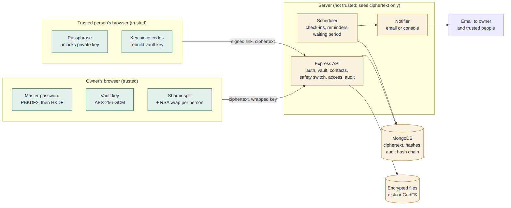
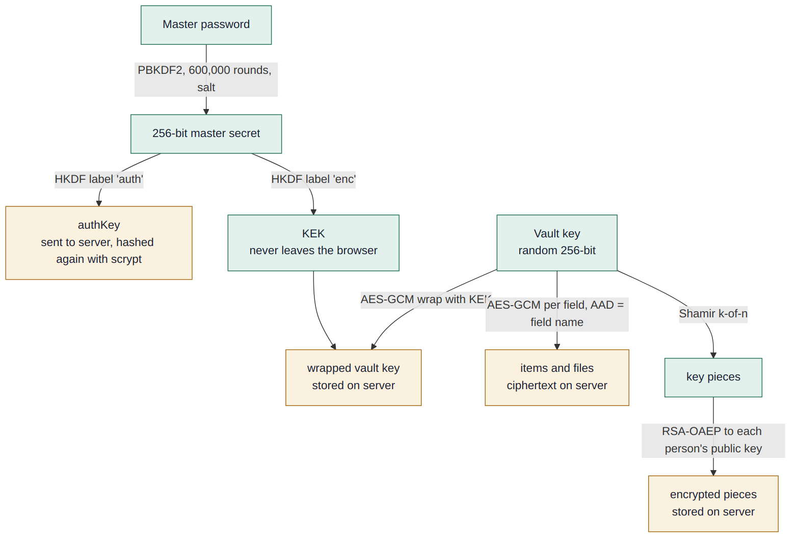
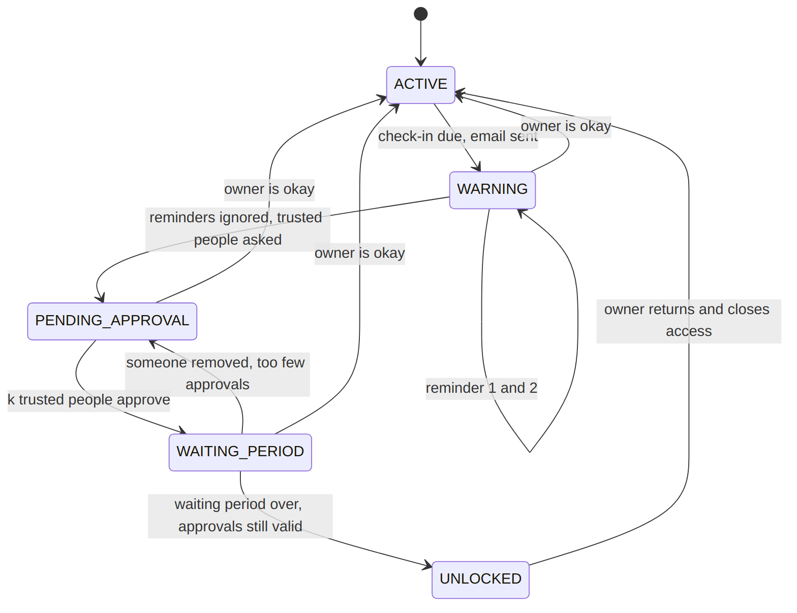
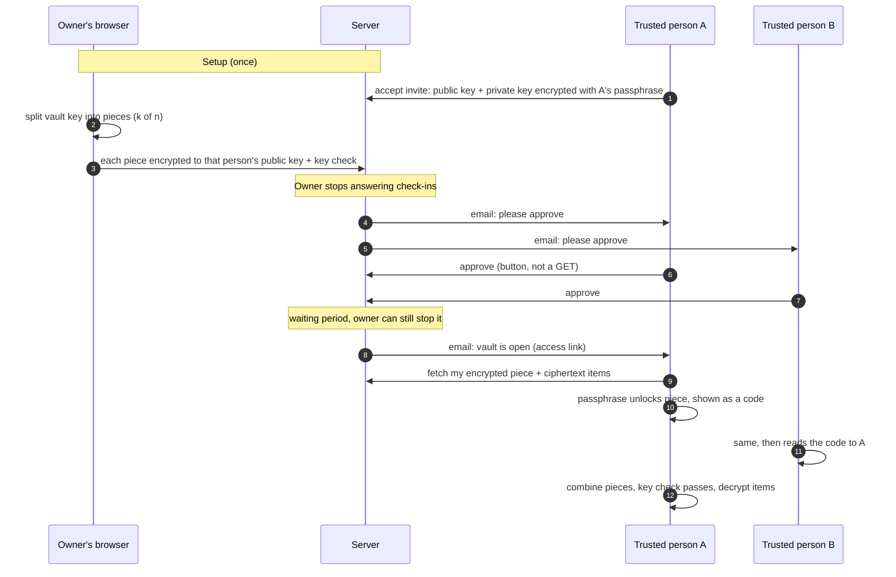

# Architecture and design decisions

## 1. The one rule

**The server is never trusted with plaintext or keys.** Everything the server stores is ciphertext, a hash, or metadata. If the whole database leaks, the attacker learns who has an account, how many items exist and which drawers they are in, but not what is written in them.

## 2. Key hierarchy

| Key | Made where | Stored where | Purpose |
|---|---|---|---|
| Master password | in the owner's head | nowhere | root of everything |
| `authKey` | browser, from the password | server stores only an scrypt hash of it | sign in |
| KEK (key-encryption key) | browser, from the password | nowhere, non-extractable | wraps the vault key |
| Vault key (VK) | browser, random | server stores it wrapped by the KEK | encrypts items and files |
| Key pieces | browser, Shamir split of the VK | server stores each encrypted to one person's public key | emergency access |
| Contact key pair | contact's browser | public key on server; private key encrypted with their passphrase | receive a piece |

HKDF with two different labels makes `authKey` and the KEK independent: knowing one tells you nothing about the other. That is why one password can both log you in and encrypt, while the server can only do the first.

## 3. Data model (MongoDB)

| Collection | Important fields |
|---|---|
| `users` | email, scrypt hash of authKey, KDF salt and params, **wrapped vault key**, `shares` (generation, threshold, key check), `settings`, `emergency` (state, cycleId, timers), `totp` (sealed seed, recovery hashes) |
| `vaultitems` | ownerId, **category (plaintext on purpose)**, encrypted title, notes, instructions, attachments |
| `encryptedfiles` | ownerId, itemId, IV; the bytes live in disk or GridFS storage |
| `trustedcontacts` | name, email, status, public key, encrypted private key, **encrypted share**, share generation, allowed categories |
| `emergencycases` | state, threshold and share generation (snapshot), approvals, timestamps |
| `auditlogs` | per-owner sequence number, actor, action, small meta, `prevHash`, `hash` |

Category is plaintext so the server can enforce drawer permissions. The trade-off is that the server learns the category, never the content.

## 4. The flows

### Safety switch

The state machine (`services/emergencyStateMachine.ts`) is **pure**: it takes the current state and the time, and returns the next state plus a list of effects. It knows nothing about databases or email, so the whole timeline can be tested in milliseconds. `services/emergency.ts` is the thin layer that applies a transition with a conditional update (filter on the old state and cycle id) and sends emails only if the update matched.

### Opening the vault

## 5. Design decisions

| Decision | Why | Trade-off |
|---|---|---|
| Client-side encryption with AES-GCM and a different **AAD per field** | A malicious server cannot move the "notes" ciphertext into the "title" slot | The AAD does not include the item id yet, so two titles could still be swapped |
| One password, two keys through HKDF | Easier for families than two secrets | Anyone who gets the password gets both |
| scrypt over `authKey` on the server | A leaked database hash cannot be replayed as a login | extra CPU per login |
| Shamir implemented from scratch over GF(256) | Easy to explain line by line; tested against the AES field test vector | Not audited; a library would be safer in production |
| **Key check** stored with the shares | Shamir returns garbage, not an error, for wrong pieces. Decrypting a known sentence proves the key is right | none |
| RSA-OAEP 3072 for the contact key pair | Small payload (33 bytes), native Web Crypto, no extra library | slower key generation than elliptic curves |
| Fingerprint check by phone | The server is untrusted, so it could swap a contact's public key | needs a human step |
| Pieces exchanged as **Crockford base32 codes with a checksum** | The server never sees a piece. Typos are caught | people must pass codes along |
| Stateless **HMAC-signed links**, usability decided by the database | No token table to leak. A rotated `cycleId` kills every old link | rotating the server secret invalidates links |
| **GET never changes anything** | Email scanners open links automatically | one more click for people |
| MongoDB polling scheduler with a lease, not Redis and BullMQ | Nothing extra to install. Safe with two server processes | polling delay up to one tick |
| State written before the email is sent | Never sends an email for a state change that did not happen | an email can be lost (needs an outbox) |
| Hash-chained audit log with a per-owner queue and a unique index | Tamper evidence and no lost entries under bursts | tail cuts need an external fingerprint |
| TOTP written by hand (RFC 6238) | No dependency; tested against the RFC vectors | maintain it yourself |

## 6. What is deliberately not here

Account recovery through trusted people, vault key rotation, per-drawer keys, a notification outbox, WhatsApp, integration and end-to-end tests. See the roadmap in the main README.

---

Diagram sources are the `.mmd` files in `docs/img` (Mermaid). GitHub also renders them natively; to rebuild the PNGs use `mmdc -i docs/img/architecture.mmd -o docs/img/architecture.png -b white -s 2`.
